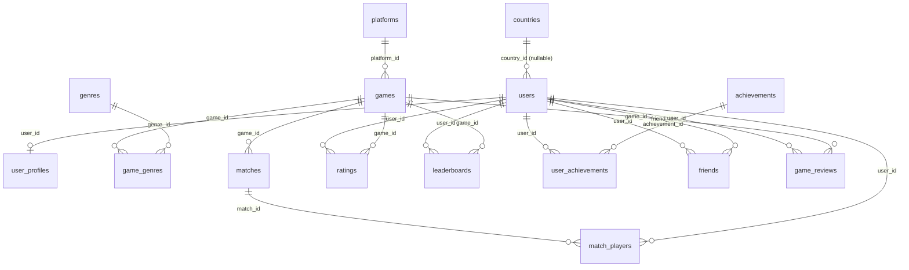

# Onlayn o'yin foydalanuvchilari va reytinglari bazasi

Mavzu №5. 15 jadvalli ma'lumotlar bazasi, tartibsiz (iflos) ma'lumotlarni tozalash (DataOps),
analitika, sayt (GitHub Pages) va CI/CD.

## Pipeline
`schema.sql` -> `generate_data.py` (iflos data/raw.db) -> `clean_analyze.py` (data/clean.db + docs/index.html) -> `pytest` -> GitHub Actions -> GitHub Pages

## Ishga tushirish
```bash
pip install -r requirements.txt
python generate_data.py
python clean_analyze.py     # docs/index.html (sayt) hosil bo'ladi
pytest -v
```

## 15 jadval
countries, users, user_profiles, platforms, genres, games, game_genres, matches, match_players,
ratings, leaderboards, achievements, user_achievements, friends, game_reviews

## Tartibsiz ma'lumot muammolari va yechimi
| Muammo | Yechim |
|---|---|
| Dublikat foydalanuvchilar / do'stlar | `drop_duplicates` |
| Noto'g'ri email (manzil tuzilishi), katta-kichik harf | olib tashlash / `lower()` |
| Davlat nomi turlicha (UZBEKISTAN, uz, " uzbekistan ") | `countries` jadvali bilan moslashtirish |
| Tug'ilgan yil 1850/2035 | `NULL` qilish |
| Sana formatlari aralash | yagona `YYYY-MM-DD` |
| Manfiy/bo'sh score, davomiylik | o'chirish / mediana bilan to'ldirish |
| ELO = 9999 yoki bo'sh | o'chirish (0..3000 oralig'i) |
| Baho 0 yoki 11 | o'chirish (1..5) |

## Rollar
| A'zo | Rol | Vazifa |
|---|---|---|
| 1 | Data Engineer / DB | `schema.sql`, ER-diagramma |
| 2 | DataOps | `generate_data.py`, `clean_analyze.py`, sifat hisoboti |
| 3 | Data Analyst | SQL so'rovlar, grafiklar, xulosa |
| 4 | Tester (QA) | `tests/`, test hisoboti |
| 5 | DevOps / CI-CD | `.github/workflows/ci.yml`, GitHub Pages, branch qoidalari |

**Guruh a'zolari:** 1) Mashhurbek — Data Engineer / DB, 2) Lochinbek — DataOps, 3) Og'abek — Data Analyst, 4) Akrom — Tester (QA) + DevOps / CI-CD |

## ER-diagramma



## Baza yaxlitligi

`schema.sql` — iflos ma’lumotni saqlovchi raw sxema. `sql/clean_schema.sql` — qat’iy clean sxema:
15 jadvalning barchasida asosiy kalit bor; bog‘lanishlarda FOREIGN KEY; email, yutuqlar,
do‘stlik va reytinglarda UNIQUE/PRIMARY KEY; ELO, baho, level va score uchun CHECK mavjud.
Yozish ulanishida `PRAGMA foreign_keys=ON` ishlatiladi. Indekslar matchlar, reytinglar va sharhlar tahlilini qo‘llab-quvvatlaydi.
Ustunlar tavsifi: [DATA_DICTIONARY.md](DATA_DICTIONARY.md).

## Dashboard

[Saytni ochish](https://malimov707-cpu.github.io/Onlayn-o-yin-foydalanuvchilari-va-reytinglari-bazasi/)

- Oq kartochkalar, pastel ko‘rsatkichlar, yon menyu va mobil moslashuv.
- Umumiy ko‘rinish, analitika, qidiriladigan o‘yinchilar, platforma bo‘yicha filtrlanadigan o‘yinlar.
- 15 jadval uchun oldin/keyin hisoboti, tozalash amallari va noma’lum qiymatlar izohi.
- Natijadan hisoblanadigan tahliliy xulosalar, CSV/JSON yuklab olish va SQL fayllari.
- Ma’lumotlar sun’iy, real bozor statistikasi emas. Hisoblar faolligi `is_active` maydonidan olinadi.

Manba interfeys `web/` ichida. `dashboard.py` bazadan `docs/data.json`, CSV/JSON fayllar va saytni tayyorlaydi.
`docs/` hosil qilinadigan natijadir; HTML/CSS/JS o‘zgarishlarini `web/` ichida bajaring.
Mahalliy ko‘rish (`file://` orqali fetch ishlamasligi mumkin):

```bash
python clean_analyze.py
python -m http.server 8000 --directory docs
# http://localhost:8000
```

## Analitika va talqin

`analytics.sql` ichida 7 ta nomlangan SQL so‘rovi bor; Python ularni to‘g‘ridan-to‘g‘ri bajaradi.
ELO bo‘yicha yetakchilar kamida 2 ta reyting yozuviga ega. Davlatlar ELOsi reyting yozuvlari
bo‘yicha o‘rtacha; davlati noma’lum hisoblar bu hisobga kirmaydi. G‘alaba ulushi kamida 15 ta
yaroqli match ishtiroki asosida hisoblanadi. Tozalashda ishtirok yozuvlari o‘chirilishi mumkin,
shu sababli bu natija boshlang‘ich barcha matchlar bo‘yicha g‘alaba ulushiga teng bo‘lishi shart emas.
Chegaraviy oylar to‘liq bo‘lmasligi mumkin. Saytdagi xulosalar har bir generatsiyada natijalardan yangilanadi.

## Sifat siyosati

Noma’lum davlat NULL bo‘lib saqlanadi va hisobotga chiqadi. Tug‘ilgan yil hisoblagichi dastlabdan
bo‘sh bo‘lgan va yaroqsiz qiymatlarning ikkalasini ham qamrab oladi. Bir martalik yutuqlar
`(user_id, achievement_id)` bo‘yicha birlashtiriladi. Do‘stlik yo‘naltirilgan: A→B va B→A alohida yozuvlar.
Foydalanuvchi o‘chirilganda unga tegishli bog‘liq yozuvlar ham filtrlanadi. Leaderboard har bir
o‘yin/mavsumda 1 dan boshlab qayta raqamlanadi. Sifat hisoblagichlari turli bosqichda olinadi;
ularni qo‘shib jami o‘chirilgan qatorlar deb talqin qilmang. Aniq kamayish `quality.tables` ichida.

## Testlar va CI/CD

```bash
pytest -v --junitxml=reports/tests.xml
node --check web/app.js
```

15 test: jadvallar soni, tozalash qoidalari, bog‘lanishlar, baza cheklovlarining haqiqatan
noto‘g‘ri yozuvni rad etishi, takrorlar, uzluksiz leaderboard, sanalar va hisobot mosligi.
Pipeline takror bajarilganda leaderboard natijasi barqarorligi ham tekshiriladi.
GitHub Actions Python 3.12 da testlarni va JavaScript sintaksisini tekshiradi.
JUnit XML `test-report` artifactida saqlanadi. Faqat `main` dagi muvaffaqiyatli tekshiruvdan
keyin GitHub Pages nashr qilinadi; pull request faqat tekshiruvdan o‘tadi.
Branch himoyasi alohida GitHub sozlamasi bo‘lib, bu workflow uni avtomatik o‘rnatmaydi.
